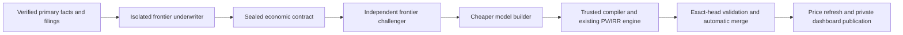

# Autonomous company underwriting

The underwriting queue covers the dashboard's complete company universe. It
distinguishes reviewed assumptions from numerical screening estimates. Prices
are not underwriting evidence and do not cause paid model work.

The first priorities are BKNG, F and OPEN, followed by existing models with new
financial reports and models still using generic assumptions. The initial limit
is one company per run, up to three when explicitly requested. The shared model
policy admits at most 18 paid stage calls per UTC day, with two calls per company
per role, and at most 100 minutes of model work per run. Change limits in
`_system/config/underwriting_policy.json` and `llm_usage_policy.json` together.



GitHub Actions schedules and controls the workflow. Cursor's cloud SDK runs the
AI sessions: GPT-6.1 Sol with High reasoning authors the company assumptions;
a fresh GPT-6.1 Sol High session independently challenges them; Cursor Auto
builds only the approved contract. When available, Auto uses Cursor Router's
Cost mode; otherwise it uses the documented server-selected Auto. The preflight
checks the account's actual model catalog before any paid work and stops if the
exact GPT model or High reasoning is unavailable. There is no GPT fallback.
Requested selections, reasoning effort and provider-reported resolved selections
are saved in the stage receipts. Each role receives a separate cloud agent.

The model service gets no repository, prior valuation, classification, current
stock price, private account credentials, broker or ThetaData access. It receives
a content-addressed primary-evidence packet. Numeric observations retain their
period, units, scope and filing locator. Source tables and business/risk passages
are frozen. Supplemental facts must match an actual frozen table, number, year
and scale; an agent cannot overwrite a structured fact's value.

Depositary receipts require a sourced ordinary-shares-per-receipt ratio. The
collector extracts explicit representation from frozen filings or uses the
verified listing registry; disagreements and unreconciled listing actions stay
blocked. The compiler converts every ordinary-share cash flow to the quoted
receipt exactly once, independently of currency conversion.

The author chooses the economic framework, company classification, material
claim inventory, assumptions, scenario drivers and realization dates. There
are no automatic growth, retention, terminal, horizon or discount assumptions.
The challenger must cover every assumption and material claim. Deterministic
sensitivity tests show which parameters drive value. A major challenge blocks
publication and returns to the author within the call budget.

Rejected drafts and complete critiques survive batch boundaries in the private
runtime. The next attempt receives the previous contract and accumulated findings;
it does not replay a rejected first draft. Approved author/challenger work resumes
at the builder after a budget or provider interruption. New evidence packets,
instructions or model-policy changes invalidate the matching checkpoint.

The builder cannot change the sealed contract: its entire model is compared to
the trusted compiler's output. Unit, source, share-basis, scenario, PV/IRR and
current-price checks run before the active model is replaced. Missing evidence,
provider failures, unsupported economics or conflicting edits produce explicit
gaps and automatic retries; they never activate a generic fallback or require a
human approval. Capital decisions remain outside this research pipeline.

Frozen packets, stage caches and paid-call ledgers live in the private research
vault's `valuation-underwriting/` directory. They are preserved before opening
the model PR. Public company artifacts are `underwriting_contract.json`,
`underwriting_review.json`, `underwriting_receipt.json`, and the compiled
`valuation.json`. The existing contract/route sidecars are refreshed together.
The CI validator reads trusted code from main and candidate data separately;
it recompiles the model from its exact private packet. It cannot execute agent
code. Automatic merge retains the repository's existing exact-head checks.

PR creation uses the existing research service credential only for the creation
request; other operations keep the repository Actions token. Organization-wide
Actions-token restrictions remain unchanged. To retry a preserved producer branch
without paying for another underwriting run, dispatch `underwriting-publish-branch`
with `client_payload.branch` equal to `codex/underwriting-<run id>`. Recovery verifies
the source workflow and a data-only diff, then requests the same exact-head checks.

After merge the publisher explicitly requests a price-only refresh because
GitHub-token pushes do not chain ordinary push workflows. Repricing also runs
after a successful Market Close workflow, with weekday 16:37/20:37 Eastern
fallbacks. Financial collection retains the existing 08:23/18:23 Eastern runs.
Exchange-calendar expiry continues withholding stale cached values.

Inspect the queue without paid calls:

```bash
python _system/scripts/underwriting_pipeline.py queue
python _system/scripts/underwriting_pipeline.py run --tickers BKNG,F,OPEN --limit 3
```

Execution is through **Autonomous company underwriting**, using its configured
schedule, source-refresh completion event or repository dispatch
`valuation-underwriting-run` (`client_payload.tickers`, `client_payload.limit`).
Only the explicit `--launch` path calls models. Local experiments should use an
isolated vault rather than a user's dirty research-vault checkout.

The batch summary reports selected, validated and blocked companies separately.
Each reviewed model is invalidated by a changed economic source fingerprint,
new primary report, model change or its review due date. Quote changes alone
only reprice the existing dated cash flows. Company-specific review does not
guarantee an investment outcome; screening-only estimates remain labelled.
