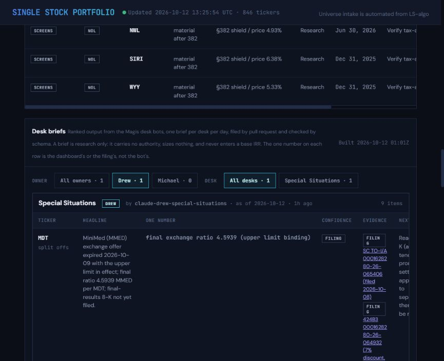
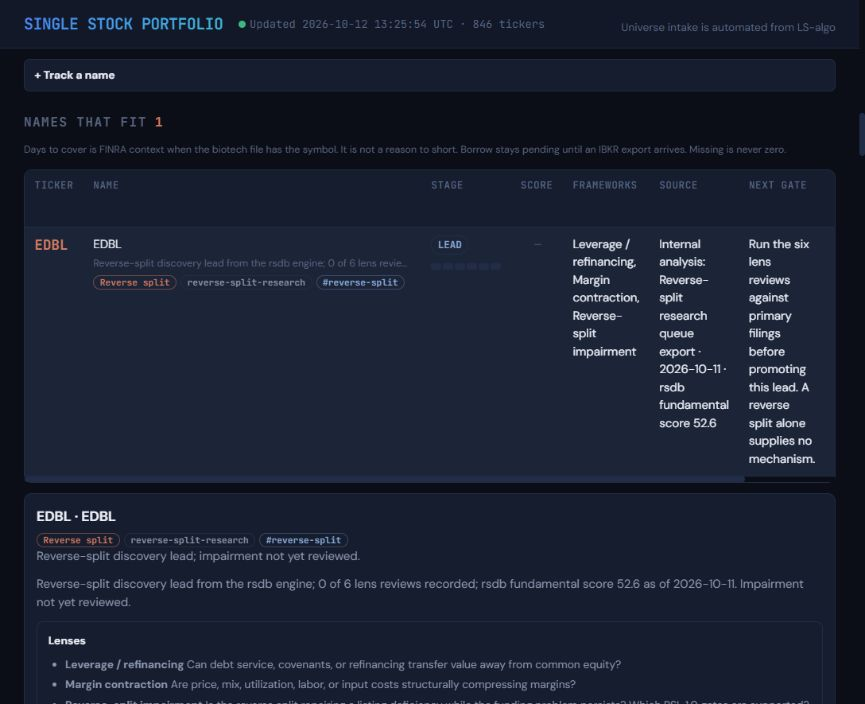
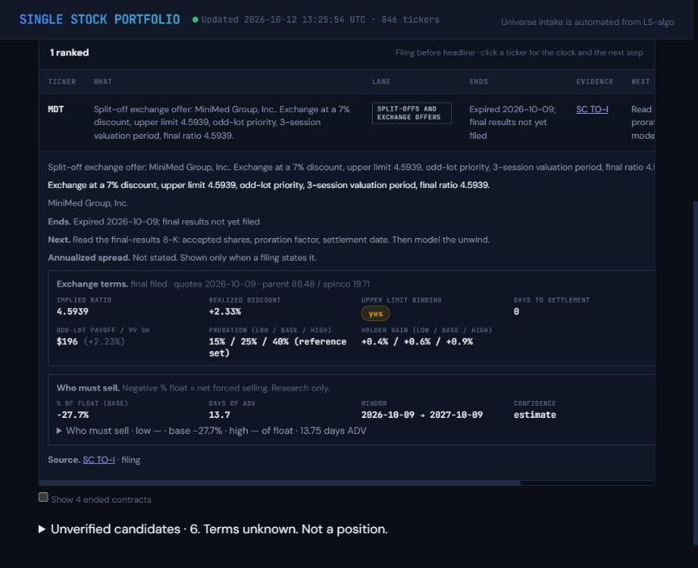
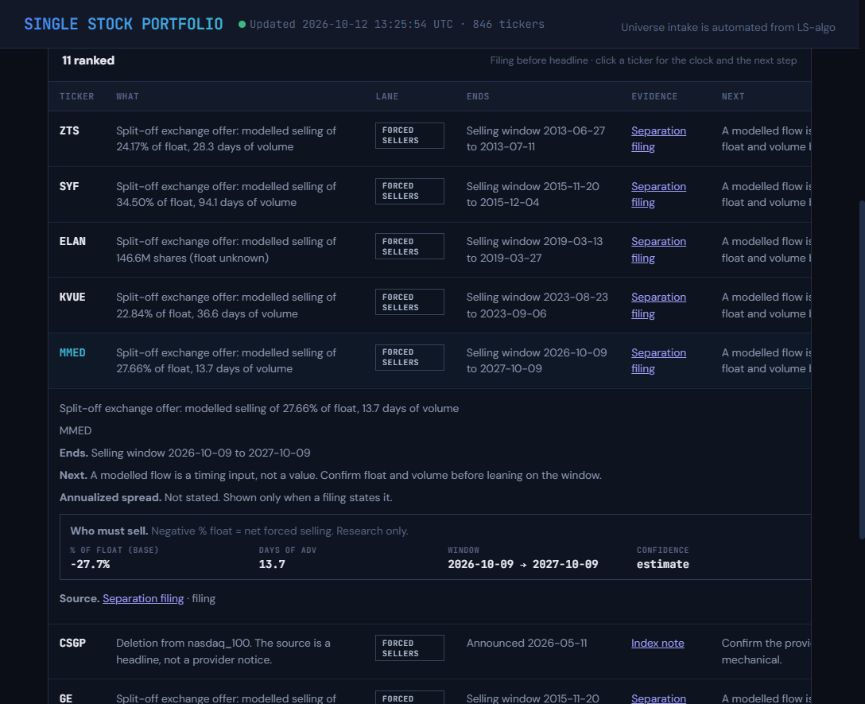
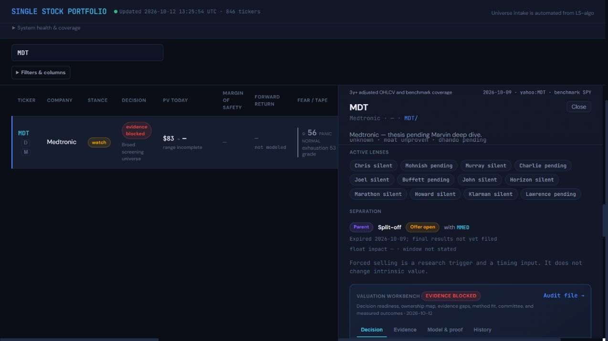
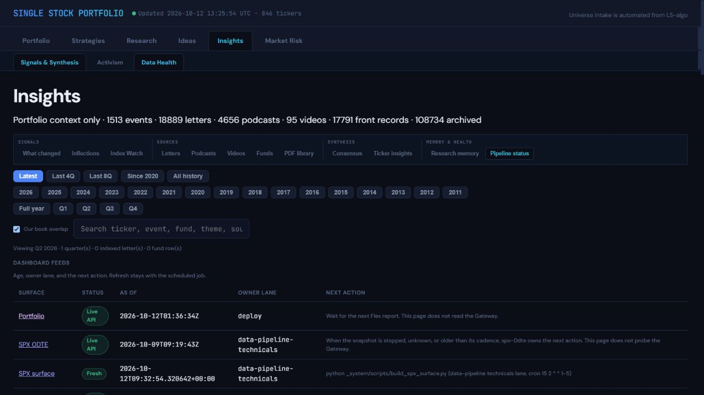

# Hub render verification October 12 2026

Source artifacts: main `775173fa0c37d027e1d0230422e7b5d274f9510c`; core built `2026-10-12T13:25:54Z`. Research only; `research_only: true`, `in_base_irr: false`, `authority: none`.

The local preview initially froze when MDT detail opened. `OverlapViz.fillTicker` recursively called itself after the optional overlap API returned 404 and its cached promise resolved to null. This created an unbounded chain of microtasks. The fix returns on an empty payload, leaving the optional overlap line hidden and allowing the rest of the ticker detail to render. A regression test fails against the previous code and passes with the fix. Existing tests were not weakened.

The Node component harness calls production renderers against committed artifacts. It verifies the following views, including their detail rows. Browser navigation then verified the actual SPA and lazy-loaded panels at port 8795. The browser console returned no error entries after the corrected MDT render; local authenticated `api/*` requests returned the expected 404 responses.

| View | Verified behavior | Evidence |
|---|---|---|
| Ideas Inbox | Special Situations brief, owner, author and dated input ages | Component harness and Inbox screenshot |
| Ideas Shorts | EDBL category, source, tags, summary and six unreviewed lens cells | Component harness and short-entry screenshot |
| Reverse splits | Recent announcements and repeat splitters | Component harness and actual Shorts DOM |
| Split-offs | Medtronic and MiniMed exchange terms, expiry and modeled selling context | Component harness and exchange screenshot |
| Forced sellers | MMED modeled flow, window and estimate label | Component harness and forced-seller screenshot |
| MDT detail | Separation card and MMED counterparty link | Component harness, full-SPA diagnostic and browser screenshot |
| Insights Data Health | desk-briefs, reverse-splits, separations, short-alpha and special-situations feeds | Feed contract and actual browser table |

Run `node dashboard/preview/spa-harness.mjs <scratch-directory>` to regenerate the component report. The report identifies its scope; it does not claim authenticated API coverage or pixel-layout validation. Browser screenshots below supplement it. Derived JSON, source ledgers, stances, targets and sizing were not edited.

Validation retains the known main timer-test failure as a disclosed finding. P3 and P6 pass; the sparse source checkout has E5 omissions and the full source checkout has the pre-existing E7 finding. Regenerated graph reports and baselines stay outside git. Authenticated hosted rendering was not verified. The separate deployment record proves that Pages published the checked commit; it does not prove a render behind Access.
